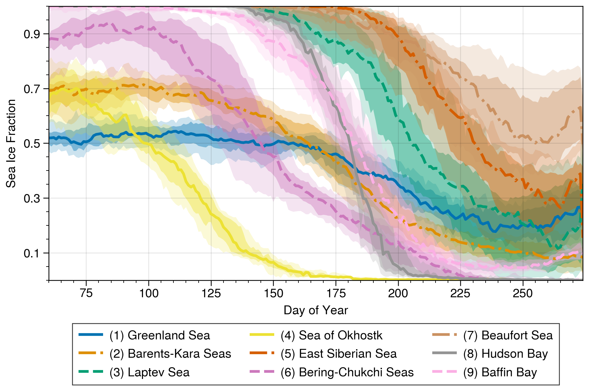
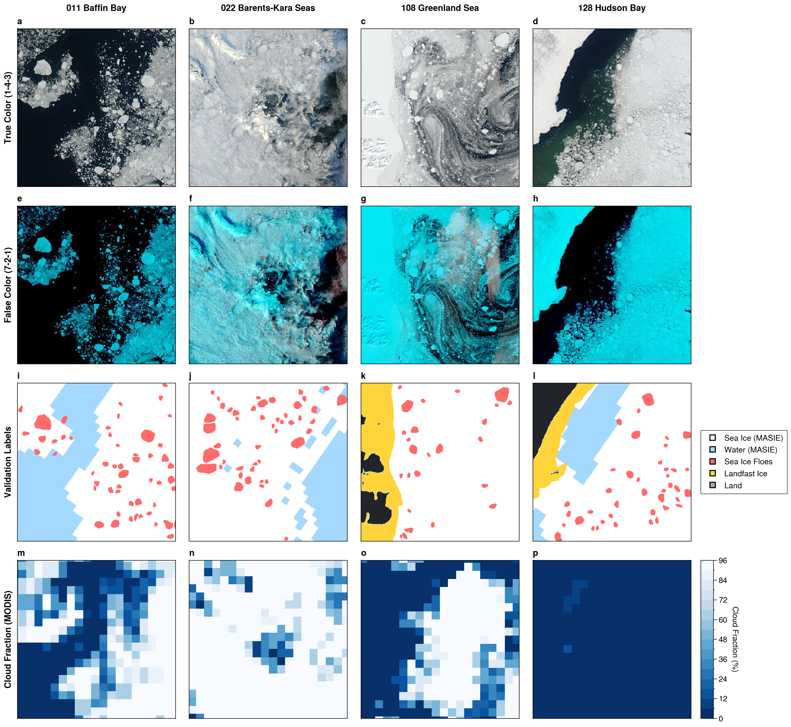

# The Ice Floe Validation Dataset
Daniel M. Watkins, Ellen M. Buckley, Minki Kim, and Monica M. Wilhelmus

The Ice Floe Validation Dataset is a collection of randomly sampled scenes spanning the circumpolar Arctic marginal ice zone developed for calibration and validation of the [Ice Floe Tracker Julia package](https://github.com/WilhelmusLab/IceFloeTracker.jl).
The data set consists of 189 cases, each defined by a date and center location and containing 100 km by 100 km true color and false color MODIS images from both the \textit{Aqua} and \textit{Terra} satellites, corresponding binary land masks, manually labeled sea ice floes, and manually labeled landfast ice. Each case includes manually assessed metadata and supplementary sea ice concentration and sea ice extent masks and MODIS 5-km cloud fraction data. Sea ice extent maps come from the the Multisensor Analysis of Sea Ice Extent (MASIE) 4-km product (US NIC, 2010), and regridded sea ice concentration maps from the 25 km-resolution NSIDC/NOAA Climate Data Record of Sea Ice Concentration (v6, Meier et al. 2026) and 6.25 km-resolution ARTIST Sea Ice Algorithm (Spreen et al., 2008).

## Methods
Samples come from 9 regions shown in Figure 1 and defined in the table below.
The large-scale bounding box for each region is defined using the center latitude and longitude with lateral (X,Y) dimensions in kilometers on the NSIDC North Polar Stereographic grid (EPSG 3413). 
Boundaries approximate the location of marginal sea borders defined by the International Hydrographic Organization, adapted to form simple boundaries in polar stereographic coordinates.


Samples consist of 100 km by 100 km scenes centered on pixels with SIC between 15 and 85\%, with SIF $\geq 0.25$.
Climatological sea ice concentrations are shown with shading in Figure 1. 
Within each region, we based the end of the spring-summer sea ice season on the climatology of sea ice fraction (SIF) for 2003-2022. The minimum sampling day of year (DOY) is set to 60 for all locations, while the maximum DOY is set to either day 273 or to the latest day on which the 90th percentile of SIF is greater than or equal to 0.5, whichever is earlier.
Although the MODIS record is longer, we restrict sampling to begin in 2006 to match the availability of MASIE ice extent data. Future work may extend the dataset to span the full period of concurrent *Aqua* and *Terra* observations.

|  Region   | Center Latitude | Center Longitude | End Date |
| --- |  --- | --- | --- |
| (1) Greenland Sea	| 74.698 | -17.601 | Sept. 30 |
| (2) Barents-Kara Seas	| 75.617 | 53.223 | Sept. 30 |
| (3) Laptev Sea | 75.9228	| 124.689 | Sept. 30 |
| (4) Sea of Okhostk | 58.000 | 148.000 | June 08 |
| (5) East Siberian Sea	| 75.171 | 165.192 | Sept. 30 |
| (6) Bering-Chukchi Seas| 65.596 | -169.076 | Aug. 24 |
| (7) Beaufort Sea | 74.860	| -142.840 | Sept. 30 |
| (8) Hudson Bay | 58.143 | -83.965 | Aug. 06 |
| (9) Baffin Bay | 74.768 | -64.085 | Sept. 30 |



The random sampling procedure is as follows. Given a region bounding box its corresponding day-of-year (DOY) range, we select a year and DOY at random. We then identify all grid points in the NSIDC CDR SIC product for that date with sea ice concentration between 15 and 85%. If the 100 km by 100 km box surrounding the candidate point has SIF > 25%, then the location, date, mean SIC, and SIF are added to a list of candidate samples. We continue sampling until each month has at least 10 candidates. Next, we manually screen candidates for data quality. If the true color or false color MODIS images for the case are corrupted or missing, or if it is apparent from examination of the MODIS, MASIE, and NSIDC CDR SIC data that the SIC data is erroneous, we reject the sample. 
Samples were drawn until sufficient quality cases were identified to draw 21 samples per region, stratified by month. Thus, most regions include 3 samples for each calendar month from March to September; for regions with shorter sea ice seasons (Bering-Chukchi Seas, Hudson Bay, and Sea of Okhostk), the remaining samples are randomly divided across months.

Metadata for each case contains visual assessments of image contents and calculations from the external data sources. Image analysts recorded "yes" or "no" for the categories

* visible sea ice
* visible landfast ice
* visible floes
* visible water

Analysts were asked to provide a rough estimate of the fraction of the image covered in cloud, and to describe the cloud cover as "none", "thin", "scattered", or "opaque". Finally, analysts noted "yes" or "no" for the presence of artifacts in the images, e.g. visible boundaries between composite images or corrupted pixels in the image. Each image was examined by at least two analysts. Image labeling was carried out using Adobe Photoshop software, with analysts manually identifying the boundaries of all floes larger than 64 pixels. Floes with ambiguous boundaries were omitted. Figure 3 shows a sample of images, manual labels, MASIE ice extent, and MODIS cloud fraction information from the dataset.



In total, the dataset contains over 5,000 labeled floes across the 189 cases. The results of the qualitative image assessments are shown in Figure 4a, where the decrease in sea ice extent can be seen in the decreasing number of ice floes with visible ice and visible landfast ice as the season progresses. Figure 4b shows the floe size distribution, with the characteristic nearly linear slope in log-log space. Figure 4c shows the spatial distribution of the randomly sampled cases.


## Dataset Structure
The data directory has subdirectories

1. `/metadata` containing specification/config files
2. `/modis` containing truecolor, falsecolor, landmask, and cloudfraction images. Landmask images have been converted from RGB to binary, where land=true and water=false.
   * `truecolor/`
   * `falsecolor/`
   * `landmask/`
   * `cloudfraction/`
4. `/masie` containing images from the MASIE 4 km data product, cropped and aligned with the MODIS projection via nearest-neighbors interpolation
5. `/asi` containing interpolated images of SIC from the 6.25 km resolution ARTIST algorithm (Spreen et al., 2008)
6. `/nsidc` containing interpolated images of SIC from the 25 km resolution NOAA/NSIDC Climate Data Record of Sea Ice Concentration (Meier et al., 20
7. `/validation_dataset` containing the binary PNG, labeled TIFF files, and Photoshop files. The subdirectories are
   * `binary_floes/`
   * `binary_landfast/`
   * `labeled_floes/`
   * `property_tables/`

The files all follow a strict, informative naming convention. Each scene is defined by a unique identifier with the format `NNN-region_name-100km-YYYYMMDD` where NNN is the zero-padded, three digit case number. 
1. MODIS images: `NNN-region_name-100km-YYYYMMDD.satellite_name.image_type.250m.tiff`. Each case specifies a date and location, and contains two satellite images (Aqua and Terra). MODIS image types are `cloudfraction` (RGB), `truecolor` (Bands 1-4-3), `falsecolor` (Bands 7-2-1), and `landmask`.
2. Sea ice extent and concentration images: `NNN-region_name-100km-YYYYMMDD.product.image_type.250m.tiff` have `masie`, `asi`, or `nsidc` and have image types `sea_ice_concentration` (ASI, NSIDC), `sea_ice_extent` (MASIE) and `landmask`.
3. Validation images: `NNN-region_name-YYYYMMDD-satellite-image_type.file_type`. Image types with file type `png` are `binary_floes` and `binary_landfast`. Labeled floe masks are `tiff` with image type `labeled_floes` and have integer labels corresponding to the labels in the property tables.

Finally, the `/property_tables` contains the main metadata table with all case information and manual image assessments `ice_floe_validation_dataset.csv` as well as automatically generated property tables for each image with ice floes in it, and a table of hybrid automatic/manual floe matching for paired analyses. Estimated satellite overpass time stamps for each image identified using the Satellite Overpass Identification Tool (SOIT, Hatcher 2022) are included as well.

## Notebooks
1. `bookkeeping.ipynb` Scripts and diagnostics to check the completeness of the datasets.
2. `sample_selection.ipynb` Demonstration of code usage for iterative random sampling.

## Scripts
1. `setup_locations.py` Generates the file `'../data/metadata/region_definitions.csv'` using region bounding boxes in North Polar Stereographic coordinates.
2. `calculate_sea_ice_fraction.py` 
3. `binarize_landmasks.py`
4. `extract_features_and_pair_floes.py`
5. `plot_locations.py`
6. `plot_sif_climatology.py`

# Citating the Ice Floe Validation Dataset
The dataset will be described in an upcoming paper in _IEEE Transactions on Geoscience and Remote Sensing_ "Automated segmentation and tracking of sea ice floes from optical remote sensing imagery with IceFloeTracker.jl". If you use the dataset in your work, please cite the dataset as

Watkins, D.M., E.M. Buckley, M. Kim, and M.M. Wilhelmus(2026) "Ice Floe Validation Dataset", Zenodo, [doi: 10.5281/zenodo.17716713](https://doi.org/10.5281/zenodo.17716713)

The Zenodo DOI will always link to the newest version of the dataset.

# Acknowledgments
Creation of the dataset was supported by grants from NASA and the US Office of Naval Research, under the direction of Dr. Monica Wilhelmus [wilhelmuslab.me](https://wilhelmuslab.me). Additional contributors to the data validation and labeling: Emma Slaght, Ethan Register, and Ashfaq Ahmed.

We acknowledge the use of the [NASA Worldview Snapshots](https://wvs.earthdata.nasa.gov) tool for MODIS data access.

# References

1. Hatcher, S. (2024) “Error quantification in the Ice Floe Tracker algorithm.” Honors Batchelor’s Thesis, School of Engineering, Brown University
2. Hatcher, S., Ahmed, A., Kim, M., & Wilhelmus, M. M. (2022). SOIT: Satellite overpass identification tool [Computer software]. Zenodo. https://doi.org/10.5281/zenodo.6475619
3. Meier, W., Fetterer, F., Windnagel, A., Stewart, J. S., & Stafford, T. (2026). NOAA/NSIDC Climate Data Record of Passive Microwave Sea Ice Concentration, Version 6 [Data set]. National Snow and Ice Data Center. https://doi.org/10.7265/B18J-Z797
4. Spreen, G., Kaleschke, L., & Heygster, G. (2008). Sea ice remote sensing using AMSR-E 89-GHz channels. Journal of Geophysical Research: Oceans, 113(2), 1–14. https://doi.org/10.1029/2005JC003384
5. U.S. National Ice Center, Fetterer, F., Savoie, M., Helfrich, S. & Clemente-Colón, P. (2010). Multisensor Analyzed Sea Ice Extent - Northern Hemisphere (MASIE-NH). (G02186, Version 1). [Data Set]. Boulder, Colorado USA. National Snow and Ice Data Center. https://doi.org/10.7265/N5GT5K3K. Accessed Jan-Mar 2025.

# Version history
Initial sampling and image analysis began in Spring 2024. Sampling regions were defined using equal-area boxes. An initial set of samples were drawn from 2003-2022, using v4 of the NSIDC CDR, and used for Simon Hatcher’s batchelor’s thesis in engineering to test methods for validating the Ice Floe Tracker algorithm. During the analysis, we noted four issues in the approach: 

1. Some regions, such as Hudson Bay, contained large ocean areas outside the intended region.
2. Overlapping region boundaries resulted in ambiguous region membership for samples.
3. Cases where the sample came from narrow channels which were smaller than the coastal buffer used in Ice Floe Tracker.
4. We identified multiple cases where the MODIS data was corrupted or missing, necessitating drawing more samples.
   
To address problem (1) and (2), we refined the region definitions to match the definitions from the International Hydrological Organization. We discarded samples which no longer belonged to any region. Then, we developed a sampling procedure to draw new samples such that all Marginal Ice Zone (MIZ) areas in the new sample had uniform likelihood of selection. The procedure is as follows. Consider a region $X$  and a new, overlapping region $Y$. We posses a sample of $n_X$ points from region $X$  and wish to form a sample of equal size from $Y$. Given a random sample of $m$ points from $Y$, we can separate them into $m_{Y\cap X}$  points from $Y \cap X$ (i.e., the points in $X$ that are also in $Y$ ), and $m_{Y\setminus X}$ points that are in the region of $Y$ but not in $X$. We determined the proportion $p$ of the original points to keep as  $p = m_{Y\cap X }/m$,  then based on these calculations, we randomly selected points to keep from the original sample and drew additional samples to bring the number of samples up to the original number. 

To address problem (3), we computed the ocean area remaining after landmask buffering and rejected samples with too little ocean coverage. Problem (4) simply required drawing more samples until we found samples with complete imagery. In most cases, this only required drawing one more sample. Manual labeling and metadata categorization continued over the next year.

In Spring 2025, we identified an issue with late-summer samples: erroneous high sea ice concentration in coastal waters in the NSIDC sea ice concentration dataset (Meier et al. 2021). To address this, we accessed MASIE data for comparison. This data first became available in 2006, so we restricted the samples to 2006 and onward. The MASIE dataset enabled us to flag where there were large discrepancies between estimated sea ice fraction in the NSIDC dataset and the MASIE ice extent. While the ice extent in MASIE still didn’t match perfectly with visual analysis, it did help us identify cases where insufficient sea ice was present. We drew additional samples to replace samples dropped by the the shifted time window, and continued working on manual floe labeling.

During Fall 2026, we performed a major overhaul of the dataset to address the need for a rigorous set of point samples for calibrating the Ice Floe Tracker classifier function. In addition, we found it necessary to expand the sample to include 500 km by 500 km images. These images were drawn as a superset of the 100 km images, starting from identifying the region centered at the original 100 km sample, then aligning the bounds to stay within the bounding boxes for the regions as necessary. The NSIDC Climate Data Record of Sea Ice was updated to Version 6. Re-running the sea ice fraction analysis, we found that the end date for the Sea of Okhostk occurs earlier in the season (June 9th, rather than June 22nd). This date is earlier than the dates for two of the samples: cases 171 and 173. We also noticed cases where the 100 km samples were not fully within the region boundaries due to insufficient buffering when drawing center location samples. In total, 10 cases were re-drawn. We updated the data format for the landmasks for consistency with the latest version of IceFloeTracker.jl, and we add the ASI and NSIDC sea ice concentration data as grayscale images for all cases.

# Generating the README PDF
The PDF version of the README is produced using `pandoc` via the commmand

```pandoc -s -V geometry:margin=1in -o README.pdf README.md```